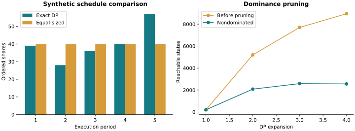

# Execution DP Lab

**Integer decisions. Path-dependent fills. A verifiable optimization frontier.**

A dynamic-programming study of splitting a parent order across a fixed horizon
when execution quality depends on a decaying memory of previous trades.



## Model

For nonnegative integer orders summing to a parent order $N$:

$$M_t=\left\lceil\frac{M_{t-1}+n_t}{2}\right\rceil,\quad
s_t=\left\lceil\max(0,1-\alpha M_t^\pi)n_t\right\rceil.$$

The objective maximizes total filled shares. The exact solver explores every
integer action and prunes states dominated in memory and accumulated reward.
The approximate solver restricts intermediate order sizes to a grid, then assigns
the exact remaining quantity in the final period.

## Run

```bash
pip install -r requirements.txt
python examples/compare_schedules.py
python -m unittest discover -s tests
```

```python
from execution_dp import exact_dp, approximate_dp
small = exact_dp(200, 5, max_states=200000)
grid = approximate_dp(2000, 5, order_step=100)
print(small['schedule'], small['total'])
```

## Evidence and limits

Tests compare exact DP against exhaustive enumeration, including non-default
parameters. The example uses N=200, T=5, alpha=0.08 and pi=0.5; it compares a synthetic schedule with equal-sized orders
and records raw versus retained state counts. Exact optimization at 100,000 shares
is **not claimed**: the source notebook uses a grid approximation at that scale.
State growth remains the main computational limitation.

The optional TSLA section needs a separately supplied `data/TSLA.csv`; the original
market dataset is excluded because redistribution rights were not established.
This is an academic execution model, not a broker execution system.

See [VALIDATION.md](VALIDATION.md) and [PROVENANCE.md](PROVENANCE.md).
